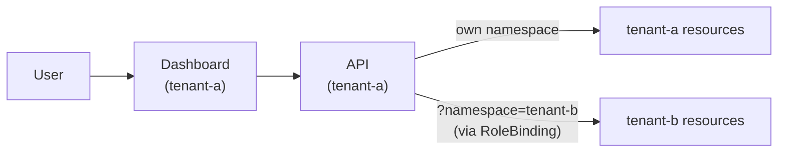

# Tenant and Namespace Management

Ark uses Kubernetes namespaces as tenants. Each namespace is an isolated environment with its own agents, models, tools, and queries. Isolation is enforced at the Kubernetes level via RBAC.

## Setting Up a Tenant

Set your kubectl context to the target namespace and use the Ark CLI to install:

```bash
kubectl create namespace tenant-a
kubectl config set-context --current --namespace=tenant-a
ark install ark-tenant
ark install ark-api
ark install ark-dashboard
```

`ark-tenant` declares `ark-broker` as a dependency, so the `ark install ark-tenant` above also installs the broker (per-tenant message, streaming, and session storage) first. The remaining two commands install the API layer and the dashboard, which you can then open with:

```bash
ark dashboard
```

> The Ark CLI uses your current kubectl context namespace. You can also install the charts directly with Helm — see the [Deploying Ark](/operations-guide/deploying-ark) guide.

A namespace without a broker silently loses conversation history: queries succeed, but the assistant never recalls a previous turn. To make that failure loud instead, a direct `helm install ark-tenant` refuses to install into a namespace with no broker Service. `ark install ark-tenant` never hits that refusal: it installs `ark-broker` first, and with `--no-deps` it passes `--set memory.requireBroker=false` so the tenant provisions without one. An existing tenant running `helm upgrade` is never blocked by the check either. Pass `--set memory.requireBroker=false` to a direct Helm install to provision a tenant without a broker anyway.

> Dashboard chat streams responses over SSE through `ark-broker` by default. If the broker is unreachable, chat falls back to polling the `Query` resource instead, with a one-time notice in the UI — so `ark-broker` is required for streaming chat, but not for chat to work at all.

If a `Memory` named `default` already exists in the namespace from a previous manual setup, `ark install ark-broker` leaves it untouched rather than failing on ownership metadata, so it keeps pointing wherever it already pointed. Annotate and label it for Helm to adopt instead: `kubectl annotate memory default meta.helm.sh/release-name=ark-broker meta.helm.sh/release-namespace=<namespace> --overwrite && kubectl label memory default app.kubernetes.io/managed-by=Helm --overwrite`.

## Cross-Tenant Access

By default, tenants are fully isolated. A user accessing Tenant A's dashboard cannot see resources in Tenant B. A cluster administrator can grant cross-tenant access using standard Kubernetes RBAC.

### Example: Two Tenants with Cross-Access

Install two full tenants:

```bash
kubectl create namespace tenant-a
kubectl config set-context --current --namespace=tenant-a
ark install ark-tenant
ark install ark-api
ark install ark-dashboard

kubectl create namespace tenant-b
kubectl config set-context --current --namespace=tenant-b
ark install ark-tenant
ark install ark-api
ark install ark-dashboard
```

At this point both tenants are fully isolated. To grant Tenant A access to Tenant B's resources, apply a RoleBinding:

```yaml
apiVersion: rbac.authorization.k8s.io/v1
kind: RoleBinding
metadata:
  name: tenant-a-access
  namespace: tenant-b
subjects:
  - kind: ServiceAccount
    name: ark-api-sa
    namespace: tenant-a
roleRef:
  kind: Role
  name: ark-tenant-role
  apiGroup: rbac.authorization.k8s.io
```

A user on Tenant A's dashboard can now view and manage Tenant B's resources by adding `?namespace=tenant-b` to the URL.



Without the RoleBinding, the API returns a 403 error when attempting to access another tenant's resources.

## Namespace in the dashboard URL

The dashboard keeps the active namespace in the URL. Open it without `?namespace=`, and the namespace it resolved to is added to the address bar once the page loads. The URL therefore always names the namespace on screen.

This has three consequences:

- **Refreshing and bookmarking keep the namespace.** Before, a reload fell back to the pod's namespace.
- **Copying the URL shares the namespace.** Another user with the same access sees the same resources.
- **An unreachable namespace is corrected.** Open a URL naming a namespace you cannot access and the dashboard reports it, switches to the namespace it can use, and replaces the value in the URL to match. A bookmark naming a namespace you have lost access to rewrites itself, so read the notification rather than the address bar to learn what changed.

The namespace is added with a history replacement, so it creates no extra browser history entry and the back button is unaffected. Deployments served under a base path keep their prefix — see [Multi-tenant dashboard hosting](/operations-guide/multi-tenant-dashboard-hosting).

## Cross-namespace references

An `Agent` can name a `Model` in another namespace (`spec.modelRef.namespace`) and a `Query` can name a `Memory` in another namespace (`spec.memory.namespace`). Ark accepts such a reference only when the target lists the referencing namespace in the `ark.mckinsey.com/allowed-namespaces` annotation, as a comma-separated list or `*`. To share a model from `tenant-b` with `tenant-a`:

```bash
kubectl annotate model shared-gpt -n tenant-b ark.mckinsey.com/allowed-namespaces=tenant-a
```

Without the annotation the admission webhook rejects the `Agent` or `Query`, and the completions executor refuses to load the target. Sharing a `Memory` across namespaces is still subject to the broker rules in the next section.

## Broker storage isolation

The cross-tenant isolation above applies to Kubernetes resources and is enforced by RBAC. The broker's message storage is a separate concern. The broker is a per-tenant component — each tenant namespace runs its own broker — while only the controller is a cluster-wide singleton.

A broker serves only the namespace it is installed in, so do not point another namespace at it. That rules out a `serviceRef.namespace` naming another namespace in an `ark-config-broker` or `ark-config-streaming` ConfigMap, a `Memory` whose address resolves to another namespace's broker, and a Query whose `spec.memory.namespace` names a broker-backed `Memory` in another namespace. The broker identifies queries by name and stores no namespace, so two namespaces sharing one broker mix their messages, sessions, and streamed chunks whenever their query names match, and deleting a query in one namespace also removes the broker data of the same-named query in the other. Give every namespace that runs queries its own broker.

When the broker uses the default in-memory message store, each broker pod holds its own messages, so isolation follows the deployment. With the Postgres message backend (`backends.message: postgres`) the `messages` table has no `tenant_id` column and no row-level security — its columns are `sequence_number`, `conversation_id`, `query_id`, `message`, `created_at`, and `expires_at`. Data isolation between tenants therefore depends entirely on the deployment, not on the data.

The Postgres event backend (`backends.event: postgres`) has the same property: the `events` table has no `tenant_id` column, and it shares the same `DATABASE_URL` and database as the messages backend. So does the sessions backend (`backends.sessions: postgres`), which adds the `sessions` and `session_queries` tables to that same database. Each per-tenant broker must point at its own database (or at least its own schema) with its own credentials. Do not share one `DATABASE_URL` across brokers of different tenants — their messages, events, and sessions would be commingled in the same tables with no way to separate them after the fact.

The same applies to the Redis chunks backend (`backends.chunk: redis`): chunk streams carry no per-tenant separation, and `REDIS_KEY_PREFIX` namespaces keys but is not an isolation boundary. Each per-tenant broker must point at its own Redis instance (or keyspace) with its own credentials — never share one `REDIS_URL` across brokers of different tenants. Traces remain in memory regardless of backend.

Storage is not the whole boundary. The broker authenticates no route, so any pod that can reach its Service can read and write another tenant's messages, events, and sessions whatever the Kubernetes RBAC says. Set `networkPolicy.enabled=true` on the broker chart to restrict ingress to the broker's own namespace plus the namespaces listed in `networkPolicy.allowNamespaces` — `ark-system` in practice, since the controller and the completions executor write from there while the broker runs in the tenant namespace. `allowNamespaces` admits whole namespaces rather than workloads, so listing `ark-system` opens the broker to every pod running there: the policy bounds reach, it does not identify the caller. The two policies in the repo are alternatives, not layers. A tenant that enables `networkPolicy.enabled` on `charts/ark-tenant` gets a namespace-wide policy that already covers its broker pods, on every port; the broker chart's own policy is for standalone installs, where it also scopes the rule to the broker's pod port. Enabling both buys nothing, because policies selecting the same pod combine as a union and the wider rule decides. Both are off by default, and enforcement is the CNI's job — a cluster whose CNI ignores NetworkPolicy accepts the object and restricts nothing.

See [Message backend (Postgres)](/developer-guide/services/ark-broker#message-backend-postgres), [Event backend (Postgres)](/developer-guide/services/ark-broker#event-backend-postgres), and [Chunk backend (Redis)](/developer-guide/services/ark-broker#chunk-backend-redis) for backend configuration.

## Marketplace installs (opt-in)

Set `marketplaceInstall.enabled=true` on `ark-tenant` to prepare a tenant namespace for installing marketplace items from the dashboard. The flag is off by default, and with it off the chart renders the same objects as before.

With the flag on, the chart creates:

- the `ark-marketplace-installer` service account, which installs run as. It is bound to the `admin` ClusterRole in this namespace and to a Role with every verb on `ark.mckinsey.com`, `create` and `patch` on `events`, and the rules in `marketplaceInstall.extraRules` (`httproutes` by default);
- Roles that let the ark-api service account, `marketplaceInstall.arkApiServiceAccount`, impersonate the installer account and manage the `marketplace-install-lock` Lease, and nothing else;
- a Role with `create` on `marketplaceinstalls` in group `ark.mckinsey.com`, bound to the subjects in `marketplaceInstall.installers`. The list is empty by default, so nobody can install until you add someone. The permission lives outside the tenant Role because RBAC only adds permissions: in the tenant Role every user of the namespace would get it;
- a ValidatingAdmissionPolicy and binding named `ark-marketplace-installer-sa-<namespace>`, plus a copy with a `-bootstrap` suffix created as a `pre-install` and `pre-upgrade` hook. The copy exists before the installer account on the first install, and also when an upgrade turns the flag on; every upgrade recreates it with the current values.

The tenant Role lets users create Jobs and Deployments, and whoever creates a pod chooses its service account. Without the policy, any tenant user could run a pod as an admin of the namespace. The policy lets only the installer account itself and the Kubernetes controllers run workloads as that account, and only the installer account create token Secrets for it. Requests that helm sends from inside the install pod carry the `authentication.kubernetes.io/pod-name` extra of the pod token, and for those the policy also refuses:

- RoleBindings to a ClusterRole, to this chart's Roles, to a Group, to a service account of another namespace or to a `system:` user;
- Roles with wildcards, rules on RBAC, Secret writes, `pods/exec`, `pods/attach`, `pods/ephemeralcontainers`, `serviceaccounts/token` or `impersonate`;
- workloads and token Secrets for the installer account;
- Secrets named like a personal secret (`u-<16 hex>-…`) or labelled with an `ark.mckinsey.com/scope` other than `shared`.
- deleting this chart's Roles and RoleBindings, personal secrets, or whole collections of Secrets or RoleBindings.

Only the ark-api service account can create, update or delete the `marketplace-install-lock` Lease; the namespace controller can also delete it when the namespace goes away. To release a stuck lock by hand, delete the policy bindings first.

A user in `installers` can install any catalogue item, and a chart can create any namespaced object, so treat installers as admins of the namespace. Objects a chart created stay after you remove the user from the list.

Requirements:

- Kubernetes 1.31 or later. With the flag on, the chart fails when the ValidatingAdmissionPolicy API is missing, so it never creates the installer account without its policy.
- Installing `ark-tenant` with the flag needs rights on cluster-scoped objects for the policy and its binding. With Argo CD, add both kinds to the cluster resource whitelist of the AppProject.
- `marketplaceInstall.arkApiServiceAccount` must name the service account ark-api runs as. The default is `ark-api-sa` in `default`. When ark-api runs in the tenant namespace, as in the setup above, set the namespace to the tenant namespace.
- Offline renders (`helm template`, kustomize `helmCharts`) cannot see the cluster API. Pass `--api-versions admissionregistration.k8s.io/v1/ValidatingAdmissionPolicy` or set `marketplaceInstall.assumeAdmissionPolicyApi=true`. Argo CD passes the cluster's API versions and needs neither.

```bash
helm upgrade --install ark-tenant oci://ghcr.io/mckinsey/agents-at-scale-ark/charts/ark-tenant \
  -n tenant-a \
  --set marketplaceInstall.enabled=true \
  --set marketplaceInstall.arkApiServiceAccount.namespace=tenant-a \
  --set 'marketplaceInstall.installers[0].kind=User' \
  --set 'marketplaceInstall.installers[0].apiGroup=rbac.authorization.k8s.io' \
  --set 'marketplaceInstall.installers[0].name=alice@example.com'
```

Check who can install with a SelfSubjectAccessReview. `kubectl auth can-i` is unreliable for `marketplaceinstalls`, which has no API behind it.

```bash
kubectl create --as alice@example.com --validate=false -o jsonpath='{.status.allowed}' -f - <<'EOF2'
apiVersion: authorization.k8s.io/v1
kind: SelfSubjectAccessReview
spec:
  resourceAttributes:
    namespace: tenant-a
    group: ark.mckinsey.com
    resource: marketplaceinstalls
    verb: create
EOF2
```

`helm uninstall ark-tenant` and deleting the namespace both leave the `-bootstrap` policy and binding behind. They match only that namespace and do no harm. Remove them with `kubectl delete validatingadmissionpolicybinding,validatingadmissionpolicy ark-marketplace-installer-sa-<namespace>-bootstrap`.

## Developing with Tenants

During development, use devspace to deploy into a tenant namespace:

```bash
devspace dev -n tenant-a
```

Or set your kubectl context and use the CLI:

```bash
kubectl config set-context --current --namespace=tenant-a
ark dashboard
```

Add `?namespace=tenant-b` to the URL to view another tenant's resources.
